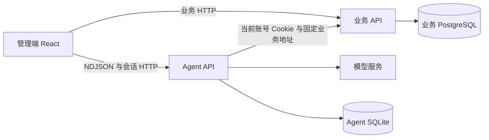

# Ethan 开发文档：完整前端与 Agent 后端

更新：2026-10-19。核对基线：当前主分支（含一天三餐、人数预测与 P0/P1 文案清理）。
本文是下一轮开发任务书，不代表下列升级已经实现。

> 2026-10-19 真实代码核对说明：本文已按当前仓库真实代码复核；补充了“一天三餐”现状，
> 并修正 Agent 撤回接口不接收请求体的描述。本次只同步文档与路由说明，不改业务逻辑。

Ethan 负责完整前端，以及唯一一项后端大任务——Agent 服务。协作者负责业务后端、计算与数据。两条线通过 HTTP 和生成类型协作，不共享内部函数或数据库连接。共同约定见 [共同契约](shared-contract.md)，对方任务见 [业务后端开发文档](partner-backend-data.md)。

## 1. 交付目标与当前基础

这一轮目标是把“登录 → 检查数据 → 表达排餐需求 → 生成可解释方案 → 人工发布 → 查看结果与导出”做成稳定完整的演示闭环。前端覆盖整个管理端，不只修改聊天页面。Agent 负责理解需求、编排工具和解释结果；营养、份数、成本和正式写入由业务 API 计算与执行。

当前主分支已经具备以下基础，应在此之上完善：

- 唯一助手入口是 `/admin/agent`。旧业务助手已删除，不再建设第二套入口或第二套模型配置。
- 独立 Agent 已支持会话、工具执行轨迹、菜单方案版本、人工发布、撤回和报告导出。
- 页面已有任务面板、对话区、结果区、人数预测、方案差异和营养差距折叠展示。
- 明日菜单与采购默认“一日三餐”：早餐固定、午餐先排、晚餐避让，三餐采购合并为一张单；
  单日与批量模式仍保留。
- 已有登录及三种角色、业务管理页面、公开展示和进场动画。
- 当前模型循环最多 5 轮、整体执行超时 180 秒，工具白名单共 11 个。升级前先复用现有实现，不重复搭建框架。

历史文档或本机暂存中的其他助手实现不作为本轮基线。实际接口以当前代码与 OpenAPI 为准。

## 2. 代码所有权：谁能改什么

| 范围 | 主要目录或文件 | 本条线责任 |
| --- | --- | --- |
| 全部前端 | `apps/web/**` | 页面、交互、视觉、路由、表单、响应式、前端测试 |
| 助手页面 | `apps/web/src/features/agent/**` | 输入条件、消息、工具状态、方案、发布与撤回反馈 |
| 全局框架 | `apps/web/src/layouts`、`src/shared/config/navigation.ts`、`src/app/router.tsx` | 导航、权限入口、页面布局 |
| 进场效果 | `apps/web/src/features/intro`、`apps/web/public/intro` | 保留已确认视觉，处理适配和加载问题 |
| Agent 后端 | `apps/agent/**` | 模型、会话、工具、HTTP 客户端、流式协议、导出与测试 |
| Agent 生成类型 | `apps/web/src/features/agent/api/schema.d.ts` | 通过 `pnpm gen:agent` 生成，不手改 |
| 业务类型消费 | `packages/api-client/src/schema.d.ts` 的引用处 | 消费业务契约；该生成文件由协作者生成并交付 |

本条线不修改 `apps/api` 的营养算法、份数预测、采购计算、数据库模型及迁移。发现计算错误时提交带请求、响应和预期计算的复现记录，不在 React 或 Agent 中补一套公式。

根目录依赖、锁文件、启动脚本、CI、Compose 和共同契约属于共享文件。每次变更先在任务记录中指定一个编辑者；同一改动不要两边各写一份。Ethan 主导前端与 Agent 的启动编排，协作者主导 API 与 PostgreSQL 配置；涉及共同文件时由当次指定者一次提交。

## 3. 运行边界与数据流



前端通过同源代理携带登录 Cookie。Agent 只转发当前用户 Cookie 到配置好的业务服务，不持有业务数据库连接、JWT 签名密钥或管理员账号。对话与任务状态保存在 Agent 自己的 SQLite，并按账号隔离。业务 API 应当在 Agent 和模型均不可用时仍能运行。

Agent 内部文件保持以下职责，避免把所有逻辑塞进 `main.py`：

| 文件 | 职责 |
| --- | --- |
| `main.py` | 认证、HTTP 路由、流式输出及人工发布/撤回入口 |
| `business.py` | 固定业务地址的 HTTP 调用与错误转换 |
| `schemas.py` | Agent 请求、会话、方案与事件模型 |
| `runner.py` | 工具循环、澄清、结果汇总与执行边界 |
| `tools.py` | 11 个受限工具的参数与执行 |
| `rules.py` | 明确标记的规则模式 |
| `store.py` | 会话所有权、版本、任务锁和请求去重 |
| `model.py`、`config.py` | 模型适配、超时和配置 |
| `exports.py`、`report.py` | 从已保存快照生成导出结果 |

## 4. 大任务 A：完整前端完善

下表中的“交付”是待完成要求；先检查已有行为，保留可用部分，再补缺口。

| 编号 | 工作范围 | 具体交付与验收 |
| --- | --- | --- |
| F01 | 导航与权限体验 | 导航名称一致；录入员、食堂管理员、学校管理员看到符合权限的入口；学校管理员不显示可执行的发布按钮；直接访问受限路由也有明确提示。后端仍独立鉴权。 |
| F02 | 助手工作区 | 桌面三块内容层次清楚、滚动互不遮挡；手机可顺序阅读条件、对话、方案；输入期间保留内容；执行中有真实状态；发布按钮明确指向当前版本。 |
| F03 | 业务管理页面 | 食材、菜品、配方、菜单、采集等现有页面统一加载、空态、失败和重试；表单显示字段级错误；重复点击不会重复提交；删除或停用后正确刷新引用数据。 |
| F04 | 结果表达 | 明确区分就餐人数、计划供应份数、实际供应/销售记录；营养标注每份/整餐、理论/校准/抽样；缺价格和缺营养显示“不完整”，不能展示成可信的零。 |
| F05 | 完整业务路径 | 从数据体检问题跳转到对应维护页面；修改后可返回重新检查；生成、查看采购、发布、公开展示、撤回均有可理解的结果。 |
| F06 | 视觉与可访问性 | 保留已确认宣纸进场；管理端字体、间距和颜色一致；键盘可操作，焦点可见，状态不只靠颜色；尊重减少动态效果设置。 |
| F07 | 失败恢复与性能 | 401 提示重新登录，403 显示权限原因，409 提示刷新/重算；切换会话不串消息；大表格按现有接口分页或限制展示；导出反馈与实际下载一致。 |

前端可以独立完成布局、表单、状态展示和接口模拟，不必等待计算升级。模拟数据必须符合现有响应模型，并在开发环境明确标记；禁止把模拟值混进比赛展示的实际计算结论。

`lib/compare.ts` 可以比较两个方案的已返回数值，但不能推导新的营养达标结论、重算采购或替业务 API 修正份数。

## 5. 大任务 B：Agent 后端完善

### A01：需求理解与上下文

- 允许用户连续修改日期、餐次、人数、每人预算和排除菜品，明确哪些条件沿用、哪些被覆盖。
- 人数未填时使用业务预测；用户明确输入人数时保留该输入。不要拿最近一次实际人数替代系统预测。
- “不要这个菜”等指代不明确时先展示候选并澄清；工具执行必须使用真实业务 ID。
- 验收：同一会话“明天午餐 → 预算改为 9 元 → 去掉某菜”只更新相应条件，结果显示完整最终条件；不同会话不共享隐式任务状态。

### A02：工具与依据

当前工具为：`generate_menu_plan`、`review_operations`、`list_dishes`、`get_dashboard`、`get_menu_day`、`get_dish_recipe`、`list_ingredients`、`list_holidays`、`get_current_plan`、`check_data_readiness`、`clarify_task`。

- 先使用现有 11 个工具补齐参数校验、空结果处理和可追溯来源，不以新增工具数量作为完成标准。
- 数据体检为阻塞状态时解释具体问题及维护入口；提示信息必须来自实际响应。
- 业务返回和用户输入均视作数据，不能改变系统工具白名单、业务地址或权限。
- 查询失败不编造结果。涉及指标的回答说明日期、餐次、数据范围、计算依据或缺失项。
- 验收：空菜品、模糊菜名、未知 ID、无历史数据、业务服务超时均能结束任务并保留可读失败记录。

### A03：流式执行与重试

- 保留现有任务锁、`request_id` 和 `expected_revision`；刷新或重试不重复生成同一请求。
- 页面只展示实际执行的工具轨迹，不伪造推理步骤或展示模型隐藏思考。
- 模型超时、无效工具参数、未知工具、工具失败、连接中断分别有可恢复处理。
- 验收：相同请求 ID 与相同内容可重放；同 ID 改内容返回冲突；同会话并发任务被拒绝；没有收到 `done` 时不能标记任务完成。

### A04：方案、发布与撤回

- 生成只是保存建议，正式发布必须由用户点击并确认对应版本。
- 发布只允许录入员和食堂管理员；学校管理员只读分析。
- 前端按 `publication` 与 `undone` 共同判断状态；曾发布但已撤回的版本不能继续显示“当前生效”。
- 目录、价格、配方、正式菜单或实际采集发生变化导致冲突时，保留旧方案用于查看，提示重新生成。
- 验收：旧版本、重复发布、撤回后查看报告、存在实际采集、发布后又修改菜单等场景都有明确状态；不绕过业务版本检查。

### A05：模型适配、隔离与导出

- 配置只放忽略提交的环境文件；示例使用占位符。模型名称以服务实际支持和验证结果为准，不根据口头名称硬编码不存在的模型。
- 模型模式与规则模式显式标记；失败不能无提示冒充真实模型成功。
- 模型测试默认使用模拟响应，另设人工运行的真实模型冒烟检查，避免每次测试都收费联网。
- 会话、报告和导出均验证当前账号所有权；日志不含密钥、完整 Cookie 或隐藏模型内容。
- CSV、Markdown、HTML 必须使用指定版本的业务快照，不能导出时悄悄重新计算。

### A06：Agent 契约补齐

当前 `/diner-forecast` 透传业务预测，但缺少显式响应模型，前端还有手写预测类型。补充 Agent 响应模型并重新生成类型，验证空预测与区间为空的情况。此任务由 Ethan 完成；预测算法和业务字段语义仍由协作者维护。

## 6. 接口使用规则

完整路由和字段见 [共同契约](shared-contract.md)。消息请求示例仅供协议测试，不会自动执行业务：

```json
{
  "content": "安排一餐午餐，每人预算8元",
  "parameters": {
    "on_date": "2026-10-20",
    "meal_type": "LUNCH",
    "diner_count": null,
    "budget_per_person": "8.00",
    "excluded_dish_ids": []
  },
  "request_id": "1466701a-e7e4-44d1-af35-c4bbef337833",
  "expected_revision": 0
}
```

该请求发送至已有会话的 `/messages`。`expected_revision` 使用当前会话版本，不始终写 0；重试同一次请求复用请求 ID，新任务使用新 ID。服务不接受未声明的顶层参数。

流式事件为 `status`、`trace`、`error`、`done`。收到 `error` 后仍可能收到保存状态的 `done`，客户端应继续解析；收到 `done` 后以服务端完整会话覆盖本地临时状态。处理跨网络分片的 NDJSON，不能假定一次网络读取就是一条 JSON。

| 展示状态 | 判断与操作 |
| --- | --- |
| 草案 | 有方案但无有效发布收据，可查看和人工发布 |
| 已发布 | 有发布收据且未撤回，显示日期、餐次和版本 |
| 已撤回 | 有 `undone`，保留历史发布信息，不显示当前生效 |
| 已过时 | 发布接口返回版本冲突，提示重算；这是展示状态，不新增虚构后端枚举 |
| 失败/未完成 | 显示错误与可恢复操作，不产生虚假的成功收据 |

## 7. 不等待对方也能开发的方式

| 工作 | 独立输入 | 等待对方的时点 |
| --- | --- | --- |
| 布局与组件 | 现有生成类型、合法响应样例 | 新增字段被正式确认时 |
| 流式交互 | 模拟模型与业务 HTTP 响应 | 最终真实模型冒烟与联合演示 |
| 发布和撤回状态 | 成功、403、409 等固定样例 | 业务事务规则最终验收 |
| 数字说明与缺项提示 | 当前响应中的依据、备注、缺项 | 新计算口径或新来源字段交付 |
| 导出 | 固定方案快照 | 新字段需纳入导出时 |

新增测试样例建议放入各自现有测试目录；新增目录前遵循仓库习惯，不把建议路径当成已存在文件。测试可以模拟网络边界，生产代码始终调用真实服务。

## 8. 本地启动与检查

在仓库根目录执行，先保留已有环境文件和数据库。不要把清空数据库作为普通启动步骤。首次安装按 README 准备 Node、pnpm、Python 与 PostgreSQL，Python 开发环境使用 `apps/api/.venv` 并同时安装 API、Agent 开发依赖。

```powershell
pnpm install --frozen-lockfile
pnpm db:up
pnpm dev:demo
```

演示入口是 `http://127.0.0.1:5173`，业务 API 使用 8002，Agent 使用 8001；普通 `pnpm dev` 的业务 API 使用 8000。已有演示库不会自动刷新为新种子。Docker 需要先正常启动；不要执行恢复出厂来解决普通开发启动问题。

分开启动可使用 `pnpm dev:web`、`pnpm dev:api`、`pnpm dev:agent`，但必须核对代理和 Agent 的业务地址，避免指向不同数据库。密钥只在本地环境配置，不复制到页面代码。

本条线修改后按影响运行：

```powershell
pnpm lint:web
pnpm typecheck:web
pnpm test:web
pnpm build
pnpm lint:agent
pnpm test:agent
pnpm gen:agent
```

生成契约后检查生成文件差异。`pnpm e2e` 用于端到端验收，运行前阅读配置并使用独立测试数据库；不得指向正式或个人保留的业务库。

## 9. 验收清单与交付顺序

第一批完成契约对齐、合法响应样例和已有功能检查；第二批并行完善前端和 Agent；第三批接入协作者交付，完成业务验证和演示。时间不足时优先闭环稳定性，暂缓知识库、库存扣减、多租户和自动采购等额外范围。

| 场景 | 验收结果 |
| --- | --- |
| E01 正常生成 | 条件、工具轨迹、业务结果、报告一致 |
| E02 人数修改 | 显式人数保留；不填时解释预测来源 |
| E03 缺数据 | 不编造预测/价格/营养，有修复入口 |
| E04 连续修改 | 上下文条件稳定，排除对象明确 |
| E05 模型或业务失败 | 任务结束可恢复，页面无永久加载 |
| E06 发布冲突 | 不显示已发布，不覆盖新菜单 |
| E07 撤回 | 页面、会话、报告反映撤回状态 |
| E08 角色与隔离 | 只读账号不能写，账号之间不能读对话或导出 |
| E09 手机与键盘 | 核心流程可完成，按钮不被遮挡 |
| E10 刷新及重试 | 会话可恢复，同请求不重复执行 |

每次交付附：分支与提交、修改目录、接口差异、已运行检查、未验证事项、截图或录屏、协作者需要配合的项目。先提交可运行的小批次，再集中联调；不要临时覆盖主分支去消除冲突。

完成标准：本条线检查通过、业务样例接入正确、十项场景有验证记录、无密钥提交、无越界业务公式。联合验收通过后再合并，不以页面能打开代替功能验收。
