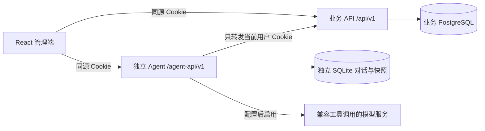

# 双人协作共同契约

版本：2026-10-17，整合同伴业务助手、批量菜单与独立 Agent。两份开发文档均引用本文，接口事实以代码中的 OpenAPI 为准。

## 责任与调用关系



- Ethan 负责 `apps/web`、`apps/agent`、Agent 契约、进场动画、联调与启动编排。
- 协作者负责 `apps/api`、业务 PostgreSQL、迁移、算法、业务契约。使用 DeepSeek 辅助编码不影响这条边界，也不决定产品模型。
- Agent 不 import 业务 service/repository/model，不持有 `DATABASE_URL`、JWT 签名密钥或管理员凭据。
- 核心业务服务不依赖独立 Agent、模型或对话库。Agent 停止时，原有业务页面仍能独立工作。
- 单食堂共享业务数据；对话按当前用户隔离。当前没有多租户、学生个人账户或个人健康档案。

## 两个助手入口的边界

- 顶部“AI 助手”保留同伴的 `apps/api/app/modules/assistant`：查业务数据、提议新增/修改/停用、采集录入、菜单同步；流式回答与确认卡、撤回记录保存在业务数据库，模型为独立的 `ASSISTANT_*` 可选配置。
- 导航“知味膳食助手”是 `apps/agent` 独立服务与专门工作区：一餐约束、多版比较、体检、报告和发布，使用 `AGENT_*` 配置；其会话仍在独立 SQLite，只通过当前用户 HTTP 调业务。
- 两边暂不共享模型配置、对话或记忆，不自动复制密钥。无模型时核心业务仍可用，独立 Agent 明确显示规则模式。
- 两边的菜单生成共用 `build_menu_plan`；原单日 `/sync`、批量 `/batch/sync` 和独立 Agent `/publish` 统一通过完整快照发布边界。显式预算、排除、人数情景缩放与批量前日排重/频次轮换一起保留。
- 业务助手的菜单/采集确认和撤回，业务变更、快照与卡片状态同事务提交。确认卡与撤回卡都检查当前版本；后续有别人的修改时拒绝覆盖。无版本凭据的历史卡片需重新提议或人工核对。
- 同步撤回精确恢复原菜单是否存在、NULL 计划份数、备注和替换信息；原发布回执保留并标记撤回，该计算快照不得再次假成功发布，必须重算。

## 两份契约的唯一来源

| 边界 | 来源 | 生成物 | 维护者 |
| --- | --- | --- | --- |
| 业务 API → 前端 | `apps/api/app` 的 FastAPI/Pydantic 模型 | `packages/api-client/src/schema.d.ts`，`pnpm gen:api` | 协作者 |
| Agent → 前端 | `apps/agent/zhiwei_agent/schemas.py` 和路由 | `apps/web/src/features/agent/api/schema.d.ts`，`pnpm gen:agent` | Ethan |
| NDJSON 过程事件 | `runner.event` 的四类事件，本文示例和客户端测试 | `features/agent/api/types.ts` 的事件联合类型 | Ethan |

生成物不要手改。字段改动时提交源模型、生成物、消费者适配和验证结果。CI 会重新生成两份类型并检查漂移。

## 业务菜单工具

`POST /api/v1/menu-plan/generate?on_date=2026-10-17&meal_type=LUNCH&diner_count=800`

可选 JSON 请求体，旧调用不传 body 仍可用：

```json
{"budget_per_person":"8.00","excluded_dish_ids":[]}
```

- `on_date` 是业务时区日期，餐次为 `BREAKFAST / LUNCH / DINNER`。
- `diner_count` 是正整数；Agent 限制到 100000。不填使用目标日期之前、同一餐次最近实际采集人次，不能借用其他餐次。
- `budget_per_person` 是元/人次的十进制字符串，最多两位小数，范围 `(0,1000]`。
- 排除菜品必须用真实 UUID；不存在或已停用的 ID 返回 422。在用但无配方/历史的菜品可以排除，不因此编造候选历史。
- 生成建议会保存计算快照和预测记录，**不会写入正式菜单或实际用量**。
- 无解返回 422，`details.conflicts` 给出核对方向，不返回一份假装满足约束的菜单。

响应沿用原 `MenuPlanResponse`，新增：

| 字段 | 含义 |
| --- | --- |
| `suggestion_id` | 不可变业务方案 ID；多次重算使用不同 ID |
| `snapshot_token` | 64 位 SHA-256 快照凭据，不是登录令牌 |
| `expected_menu_token` | 生成时这餐正式菜单的版本凭据 |
| `budget_per_person` | 本次计算使用的每人预算 |
| `requested_excluded_dish_ids` | 本次主动排除的菜品 |
| `calculation_version` | 当前计算规则版本，旧快照读取时可为空 |
| `dishes[].planned_servings` | 实际用于采购、营养及发布的计划份数；预测不足时也明确保存 |

指定人次后，份数按 `历史预测 × 指定人次 / 同餐次最近采集人次` 调整，结果与假设写入 `notes`。这是情景调整，不能解释成新增实测或保证实际销量。原始预测序列仍保存原始统计预测；这版采购与营养用调整后的同一套份数。预测只使用目标日期之前的同餐次记录；回测逐日只看当时已有记录；未核实日历不会进入修正。

## 生成前的数据体检

`GET /api/v1/menu-plan/readiness?on_date=2026-10-17&meal_type=LUNCH&excluded_dish_ids=真实UUID`

三类业务角色均可查看。完全只读，不保存预测或建议。排除 ID 可重复传，最多 50 个。响应 `PlanReadiness` 包含可用/在用菜品、近八周同餐次历史天数与记录数、可预测菜品数、最近基线、必选类别数量、缺配方/单价/营养/来源/停用材料与未核实日历等问题，以及原数据入口。`blocking` 问题会阻止 Agent 调用生成；`attention` 保留可见警告。体检只检查当前结构和资料，不认证真实性，也不保证求解成功。单次最多返回 100 项，保留总数与截断说明。

## 发布工具：只有明确确认才调用

`POST /api/v1/menu-plan/{suggestion_id}/publish`

```json
{"snapshot_token":"用生成响应中的值","expected_menu_token":"用生成响应中的值"}
```

两项必须是原响应中的完整 64 位凭据。请求不能携带菜品明细、金额或执行角色。

服务端顺序：刷新并锁定建议 → 校验快照 → 同餐次写锁 → 核对菜单版本 → 检查是否已有实际采集 → 核对配方、原料营养与价格 → 写菜单与计划份数 → 计算公开菜品营养 → 记录确认人与审计 → 提交。当前规则版本为 `menu-plan-20261017.3`。

- 菜单、配方或价格变化：409，重新生成并核对。
- 计算规则升级：未发布的旧规则快照返回 409，必须重算；已经发布的旧版本仍返回原收据，历史不能因此失效。当前规则版本由 `publication.CALCULATION_VERSION` 管理。
- 已有实际采集记录：409，不能用计划覆盖事实。
- 过去日期：422；采购金额超预算：422。
- 同一业务方案重复确认：返回原收据，`already_published=true`，不重复写审计。
- 两个不同方案竞争同一餐：最多一份以旧版本成功；另一份需重新生成。
- 已发布方案不能再通过旧 `/recommendation/{id}/decide` 改写结论。
- 原 `/recommendation/{id}/decide` 对未发布建议仍只是采纳/否决，**不等于本发布接口**。

收据包含 `suggestion_id / menu_day_id / on_date / meal_type / dish_count / published_at / published_by / already_published`。发布没有下单、付款或向供应商发送信息。

## Agent HTTP 接口

均位于 `/agent-api/v1`，除独立 `/health` 外都校验当前业务账号。

| 方法与路径 | 行为 |
| --- | --- |
| `GET /status` | 实际模式、模型名、数据说明、可操作能力；不返回密钥 |
| `GET /dishes` | 供界面选择的在用菜品，首版最多 100 条 |
| `GET /sessions` | 当前用户最近 40 个任务 |
| `POST /sessions` | 新建私有任务 |
| `GET /sessions/{id}` | 消息、方案版本、核查结果 |
| `POST /sessions/{id}/messages` | 逐步处理任务，NDJSON 响应 |
| `POST /sessions/{id}/publish` | 明确确认当前最新版本，body 为 `{"revision":2}` |
| `GET /sessions/{id}/purchase.csv?revision=2` | 导出指定版本；带草案/发布状态和数据说明 |
| `GET /sessions/{id}/review.md` | 导出本次记录核查 |
| `GET /sessions/{id}/report.html?revision=2` | 指定版本的完整自包含报告；默认下载，`download=false` 浏览器预览 |

消息请求：

```json
{
  "content":"改成1000人，其余条件不变",
  "parameters":{"on_date":"2026-10-17","meal_type":"LUNCH","diner_count":800,"budget_per_person":"8","excluded_dish_ids":[]},
  "request_id":"每次新任务请求的UUID",
  "expected_revision":1
}
```

`parameters` 是用户面板中的显式条件；自然语言的新条件可以覆盖它。未修改的条件继续保留。`expected_revision` 是当前方案数；0 表示尚无方案。相同请求编号+相同内容可重放完成结果，相同编号换内容返回 409。同会话不能并行执行任务或发布。

NDJSON 每行是一条独立 JSON，不是一个 JSON 数组，也不是模型思维链：

```json
{"type":"status","message":"正在核对任务条件","mode":"rules"}
{"type":"trace","trace":{"id":"步骤UUID","tool":"generate_menu_plan","label":"计算菜单、份数与采购","status":"running","detail":""}}
{"type":"trace","trace":{"id":"同一步骤UUID","tool":"generate_menu_plan","label":"计算菜单、份数与采购","status":"success","detail":"计算结果已返回"}}
{"type":"done","conversation":{"说明":"此处是完整 Conversation，详见生成类型"}}
```

流内失败先发 `error {message,code}`，然后发 `done` 保存后的对话。流开始前的权限/参数/版本冲突用 HTTP 状态码表达。前端必须等 `done` 才认为本次传输完整；网络断流时提示刷新已保存结果。

正常澄清通过 `done` 返回：末条消息 `kind=clarification`，包含可选 `suggestions`；`pending_task` 保存已知参数、待答字段及 `questions` 列表。规则模式逐项解决问题，只答人数不会丢失尚未确定的餐次；明确取消才清空待执行任务。候选回复不能当作已经选择。旧记录新增字段均有兼容默认值。

模型仅有 `list_dishes / check_data_readiness / generate_menu_plan / review_operations / get_current_plan / clarify_task` 六个白名单工具；每次最多生成一版，最多 5 轮模型调用，单任务总超时 180 秒。生成工具内部也强制检查数据，不能靠省略模型调用跳过；缺少体检接口会明确提示后端版本不匹配。没有发布、任意网络访问、SQL 或文件执行工具。`clarify_task` 可带 `known_parameters` 保存已经明确的条件，生成后不允许再把本次任务伪装成“未执行”。

`PlanVersion` 保存生成时 `readiness` 和 `data_notice`。完整报告从所选快照导出，不重新调用计算或模型；包括条件、菜单、计划份数、采购、营养差距、目标依据、当时的数据检查和发布状态。所有动态内容转义，报告不加载外部脚本/字体/资源。HTML 可离线查看和通过浏览器打印成 PDF，当前没有服务端原生 PDF 文件导出。旧条件复用只填面板，必须重新生成，不能把旧快照改成新日期后发布。

## 数值与来源

- 原料配方重量是克、市品口径；采购重量为公斤；单价是元/公斤市品。
- 金额用 Decimal 计算、字符串传输。采购合计是**逐项已四舍五入金额之和**，页面与导出一致。
- 营养必须保留单份/人均、理论/校准/抽样的口径区别。
- 建议目标可能未全部满足；现有中小学生资料不能直接认证大学食堂一餐全部合规，范围说明见 [营养目标口径](nutrition-scope.md)。
- 缺价时显示“已知价格部分合计”；有缺价的方案不计算确定的比较差额。未选中的缺价菜不应使当前方案成本被标记为不完整。
- 核查的 15% 剩餐比例、同餐次中位数 1.5 倍为演示筛查阈值，不能当作医学或行业标准。
- 系统异常标记、数值偏离是核对线索，不能直接认定原因。
- 零预测且实际为正时相对偏差为 `null`；两者都为零是吻合，不能凭空报告异常。

## 变更纪律

两人各用功能分支。先提供契约和正常/无数据/无解/无权限/冲突样例，再实现消费者。业务 API 出现破坏性改动时先协调，不让 Agent 猜字段。迁移、生成文件、锁文件与共享编排一次只由一人修改。一次合并一个可验收场景，记录实际测试结果，不用截图代替接口验收，也不用接口测试代替视觉检查。
